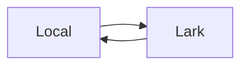

# larkmd-sync 同步设计

## 整体流程

`larkmd-sync` 对外只接受 Markdown。单篇文档用一个本地 Markdown 保存结构；图片使用 Markdown 引用的普通本地文件。工具不保存完整 XML 或树清单；原生画板使用 .board.json 保存节点与基准，自动编号标题在 Markdown 注释中保存元数据。为修复飞书特有的块属性，工具可以在内存中临时读取完整块 XML，但不会把它作为同步格式保存或暴露给用户。

拉取流程：

1. 读取远端 Markdown 和 revision。
2. 将飞书图片下载到内存，生成 `.assets/<文档名>/` 下的目标路径；Mermaid 画板由官方 Markdown 接口恢复为 fenced block。
3. 根据文档标题和 URL 生成可选 front matter。
4. 用远端 revision、正文语义哈希、图片字节哈希和本地目标原内容哈希计算 `plan_id`。
5. apply 时重新计算计划；计划仍一致才先原子写入图片，再原子替换 Markdown。工具不删除已经不再引用的旧图片。

推送流程：

1. 读取本地 Markdown，并从 front matter 或 `--doc` 获取目标 URL。
2. 移除本地 front matter；单文档从目标文件读取链接地址，文档树也可使用按层级和标题得到的运行时映射转换本地文档链接。
3. 校验本地图片，临时替换为唯一占位段落；把 fenced Mermaid 转换为飞书 Mermaid 画板标签；把 Markdown Alert 转换为带临时标记的高亮块。
4. 读取远端 Markdown、revision 和图片字节，并据此计算 `plan_id`。
5. apply 时重新计算计划；计划仍一致才覆盖 Markdown，随后在每个占位段落处上传图片并删除占位文本。
6. 如果需要恢复有序列表序号或设置高亮块样式，只读取一次完整块 XML。工具通过临时标记定位目标块，再精确写入列表序号或高亮块样式。

plan 只通过 JSON 返回，不在工作区写入文件。为了识别飞书图片格式和计算内容哈希，计划阶段会把图片读取到内存；官方 CLI 使用的临时下载目录会立即删除。原子替换使用的同目录临时文件会在 rename 后删除，不属于需要维护的同步数据。

## Front matter

本地文档可以用以下字段记录映射：

```yaml
---
title: 配置管理总体设计
feishu_url: https://tenant.feishu.cn/wiki/...
---
```

只有文件第一行是 `---`、200 行内有结束标记，且标记之间至少存在一个顶层 `key: value` 时，工具才把该段识别为 front matter。普通 Markdown 分隔线不会被删除。

`feishu_url` 和 `lark_url` 都可以作为映射字段。显式 `--doc` 与已有映射指向不同文档时，工具拒绝执行。

## 本地链接

推送和比较时，工具解析 `[接口说明](./接口说明.md)` 这样的相对链接。如果目标 Markdown 有文档 URL front matter，或 `tree push/status --doc ROOT_URL` 已按层级和标题找到对应远端节点，就把链接转换成远端 URL。以下内容保持不变：

- 外部 HTTP 图片链接；
- 外部 HTTP 链接；
- 页内锚点；
- 代码块中的示例；
- 不存在或没有文档映射的目标文件。

源文件本身不会被修改，因此本地 Markdown 仍使用适合仓库浏览的相对链接。

## 图片

本地图片使用标准 Markdown：

```markdown

```

为保证上传位置和路径安全，本地图片必须单独占一行，使用相对路径，并位于 Markdown 同目录或子目录。当前支持 PNG、JPEG、GIF、WebP 和 BMP；不跟随图片文件符号链接。

推送计划包含一条正文覆盖动作和每张图片各一条 `insert_remote_image`。apply 先写入带唯一占位文本的正文，再调用官方媒体接口把图片插入占位位置，最后删除占位文本。独立图片匹配完整占位段落；列表间图片匹配前一列表项末尾的唯一标记，并插入到该列表项之后。定位不唯一或缺少块 ID 时拒绝写入。这不是远端事务；上传中途失败时结果会明确报错，远端可能暂时保留未完成图片的占位文本。

飞书媒体接口会把图片后的有序列表重新标成 `seq="1"`，即使 Markdown 中写了 `2.`、`3.` 也会如此。工具因此在需要续号的列表项中加入唯一临时标记，图片全部插入后读取一次完整块 XML，通过标记取得 block ID 和原有行内格式，再从后向前重写这些列表项的 `seq`。更新内容沿用飞书返回的行内节点，只删除临时标记和内部 ID；本地文件不会出现 XML 或 block ID。

拉取时，图片写入 Markdown 同级的 `.assets/<文档名>/`。文件名优先使用图片说明，重名时追加序号。计划和比较使用图片字节哈希，不使用会定期变化的飞书签名 URL。

## Mermaid 画板

本地 Mermaid 使用标准 fenced block：

````markdown

````

推送时只在内存中把 fenced block 转换为 `<whiteboard type="mermaid">`，本地文件保持不变。飞书 Markdown 接口会把 Mermaid 画板直接导出为 fenced block，因此拉取不需要 `.mmd` 或画板 token sidecar。

双向同步明确覆盖 `flowchart`、`sequenceDiagram`、`classDiagram`、`stateDiagram`（包括 `stateDiagram-v2`）、`erDiagram`、`gantt`、`pie` 和 `mindmap`。识别图表类型时会跳过空行、Mermaid 注释和 `%%{init...}%%` 指令。其他声明继续透传，但不承诺飞书能够无损回导。

只有能够恢复为 Mermaid 源码的画板属于该双向能力。SVG、自由画板、PlantUML 或包含多个非源码节点的画板仍会产生阻断警告。

## GFM 表格

工具不再把 GFM 表格转换成飞书 XML。推送正文保留原始 Markdown 表格，列宽交给飞书 Markdown 转换器决定。

飞书回读时可能把表格分隔行改成 `|-|-|`。比较逻辑只归一化代码块外的表格分隔行，不忽略表格内容，所以这种格式变化不会产生伪差异。

## 高亮块

本地使用 GitHub/VS Code Markdown Alert 保存高亮块，例如：

```markdown
> [!TIP]
> 可以包含 **行内格式**、段落和列表。
```

工具支持 `NOTE`、`TIP`、`IMPORTANT`、`WARNING` 和 `CAUTION`。推送时，飞书 Markdown 导入器先创建高亮块；随后工具读取一次完整块 XML，通过临时标记找到对应 block ID，并设置固定图标、背景色和边框色。替换内容沿用飞书生成的段落、列表和行内节点，只删除临时标记和内部 ID。

飞书 Markdown 导出结果只包含高亮块图标，不包含任意自定义颜色。因此拉取时根据图标选择 Alert 类型，并返回 `callout_style_normalized` warning。下次推送会使用该类型的固定样式。无法识别的图标按 `NOTE` 处理并在 warning 中列出。高亮块内暂不允许图片、代码块、表格、Mermaid 或其他资源块。

## 文档树

`tree pull` 遍历 Wiki 根节点及其 `docx` 子节点，并为每篇文档生成独立 Markdown。默认每个文件都通过自己的 front matter 记录 URL；`--no-front-matter` 可以只保留普通 Markdown，后续通过根 Wiki URL 恢复整棵树的映射。

`tree push` 和 `tree status` 支持两种映射方式。

逐文件映射会递归扫描目录中的 `.md` 与 `.markdown`：

- 有 `feishu_url`/`lark_url` 的文件参与同步；
- 没有映射的文件被跳过并产生警告；
- 两个文件映射到同一远端 token 时产生冲突；
- 拉取不会删除远端已经移除的本地文件。

根 URL 映射通过 `tree push/status DIR --doc ROOT_URL` 启用：

1. 遍历根 URL 下的 Wiki 节点。
2. 从 `README.md`、`index.md`、与远端根标题同名的页面或唯一顶层 Markdown 中确定本地根页。
3. 使用目录层级和一级标题匹配每个子 `docx` 节点；页面没有一级标题时使用文件名。
4. 复用结果转换文档树中的相对 Markdown 链接。
5. 本地页面没有同层同标题远端节点、同层标题重复或远端同层重名时报告冲突。

`Root.md` 加 `Root/Child.md` 的布局还支持只在 `Root.md` 保存根 URL；工具会自动进入根 URL 映射。Sheet、Base 等非 `docx` 节点只报告 warning，不生成伪 Markdown。两种方式都不需要 `.larkmd/tree.json`。

## Markdown 表示限制

原生画板通过 SVG 与 JSON 配对保存，见 [原生画板同步](原生画板同步.md)。无法恢复的同步块、Base、Sheet、普通附件等结构阻止回写。完整 XML 仅在内存中用于恢复或定位已支持的标题编号、颜色、列表、高亮块和画板。

当远端 Markdown 正文出现已知专有标签，或 `lark-cli` 返回 `reference_map` 时，结果会包含 `blocking: true` 的警告。拉取和比较仍可执行；不要使用本工具回写该文档，应改用对应的飞书工具。`lark-cli` 返回的 `tips` 也会原样加入 warnings。

## 工程结构

模块分工统一维护在 [架构与代码地图](架构.md)，格式表示见 [Markdown 格式](Markdown格式.md)。

快照会恢复 Mermaid 源码和标题编号，纠正加粗边界，再处理高亮块、颜色和资源；plan、pull 和 diff 共用该快照。推送遇到原生画板时优先局部改文字或保留画板重建正文，不能把普通正文覆盖路径用于替换原生画板。编号和颜色等属性在正文导入后恢复；多步云端操作失败不具有事务回滚保证。
