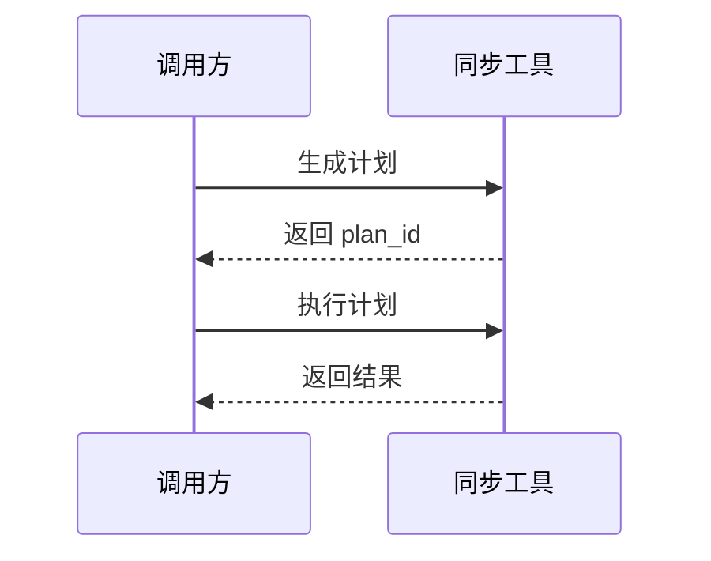
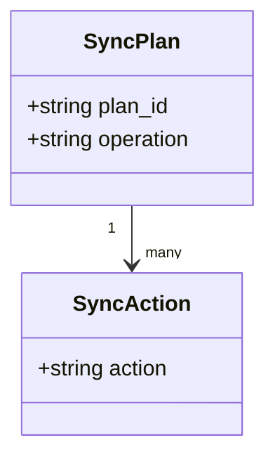
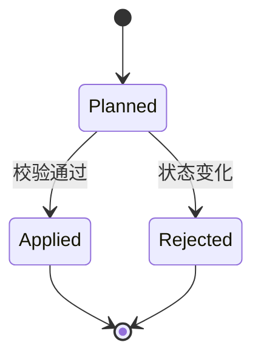
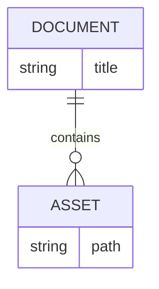
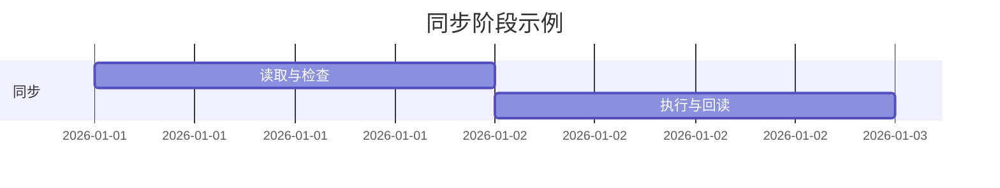
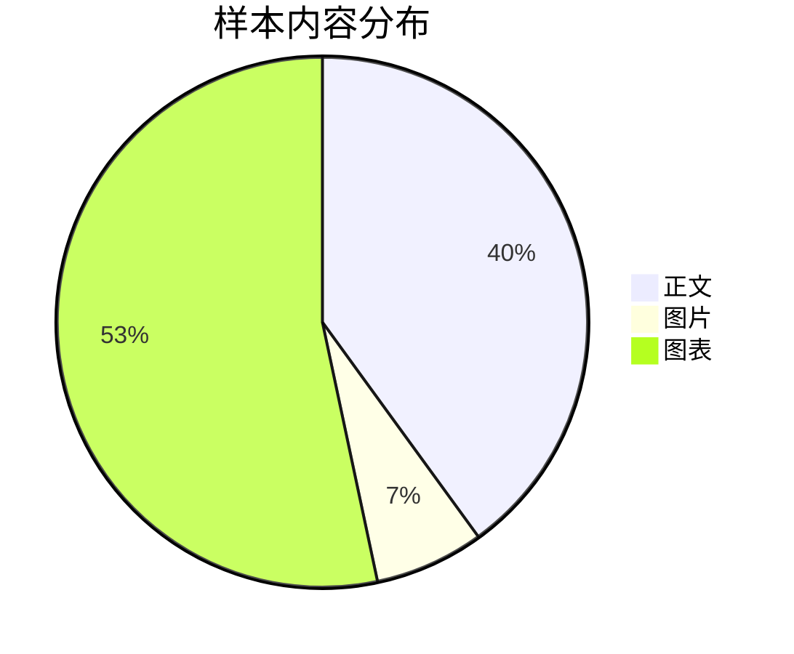
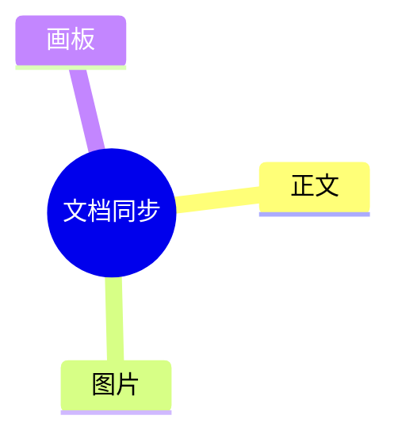
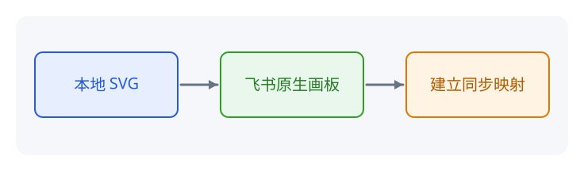

# 同步格式展示

这是一篇可推送到飞书测试文档的人工验收样本，不代表所有格式已经完成线上验证。正文展示普通 Markdown、字体颜色、本地图片、五类高亮块和八类 Mermaid；另有一张本地 SVG 首建原生画板样本，以及一篇用于验证父子文档链接的子文档；自动编号和云端引用的往返方法在末尾说明。

## 普通文本与行内格式

普通中文、English、数字 123、Emoji ✅。支持 **加粗**、*斜体*、~~删除线~~、`行内代码` 和 [项目主页](https://github.com/Huffer342-WSH/larkmd-sync)。

**一句话读懂：** 配置按 key 读取；这段也用于观察标点附近的加粗效果。

### 三级标题

不同层级的标题应保留层级关系。

#### 四级标题

##### 五级标题

###### 六级标题

## 列表、引用和分隔线

- 普通列表项
- 含 **加粗** 的列表项
  - 嵌套列表项

1. 第一步：读取内容。
2. 第二步：检查计划。
3. 第三步：执行同步。

- [ ] 待检查项
- [x] 已完成项

> 普通引用块。
> 第二行包含 **加粗** 和 `代码`。

---

## 代码块

```python
config = {"wrapper": "none"}
print(config["wrapper"])
# **这里不是加粗**，<span style="color:red">这里不是红字</span>
```

```json
{"enabled": true, "count": 3, "name": "同步样本"}
```

## 表格

| 项目 | 本地表示 | 说明 |
| --- | --- | --- |
| 正文 | **加粗**、`代码` | 保留内容 |
| 链接 | [项目主页](https://github.com/Huffer342-WSH/larkmd-sync) | 保留目标 |
| 特殊字符 | A & B | 中文与 English |

表格内容应保留，列宽由飞书转换器决定，不要求与本地渲染完全相同。

## 字体颜色

<span style="color:#d83931">红色</span>、<span style="color:#de7802">橙色</span>、<span style="color:#dc9b04">黄色</span>、<span style="color:#2ea121">绿色</span>、<span style="color:#245bdb">蓝色</span>、<span style="color:#6425d0">紫色</span>、<span style="color:#8f959e">灰色</span>。

<span style="color:#245bdb">**加粗蓝字**和[蓝色链接](https://github.com/Huffer342-WSH/larkmd-sync)</span>。

<span style="color:rgb(36,91,219)">RGB 写法的蓝字</span>；<span style="color:red">CSS 色名 red 会映射到飞书红色色板</span>。

本地渲染器可能过滤颜色样式；非色板颜色归一化属于预期行为。

## 本地图片及列表续号

图片为本仓库自带的三色色块 PNG，从左到右为蓝、绿、橙。检查色块顺序、图片完整性，以及图片后列表是否从 2 继续。

1. 图片前的第一项。


2. 图片后的第二项。
3. 图片后的第三项。

图片必须单独占行，位于本文同目录或子目录。普通图片支持 PNG、JPEG、GIF、WebP 和 BMP；此处使用 PNG 作为代表。

## 五类高亮块

> [!NOTE]
> 普通说明：保留 **加粗** 和 `行内代码`。

> [!TIP]
> 操作建议：先检查同步计划。

> [!IMPORTANT]
> 重要信息：保留原生画板的 SVG 与 JSON 配对文件。

> [!WARNING]
> 注意：写入会修改目标文档。

> [!CAUTION]
> 谨慎：遇到阻断警告应停止推送。

高亮块按类型使用固定图标和颜色，不用于保存飞书任意自定义样式；块内不放图片、表格、代码块或 Mermaid。

## 八类 Mermaid 画板

### 流程图


### 时序图



### 类图



### 状态图



### ER 图



### 甘特图



### 饼图



### 思维导图



## 本地 SVG 创建原生画板（非 Mermaid）

下图是仓库内直接绘制的 SVG。首次推送不需要配套 JSON，工具创建飞书原生画板并在成功读回后生成 JSON；之后两份文件需要一起保留。观察三块图形、箭头和文字是否一致，SVG 转换不保证所有图形属性无损。



## 文档链接与子文档

继续阅读 [文档链接与双向同步](同步格式展示/文档链接与双向同步.md)。子文档包含返回本文的链接、本页链接、外部链接和代码示例。

这组样本使用父页 Markdown 和同名子目录表示 Wiki 层级。推送整棵树时，相对链接转换为飞书地址；拉取时转换回相对路径，并在 HTML 注释中保存原地址，注释不影响本地阅读。

## 需要额外设置的往返场景

这些场景需要真实远端对象或同步基准，不能只靠手写一个 Markdown 占位验证。

| 场景 | 准备与观察方法 |
| --- | --- |
| 原生画板 SVG | 首次上传上图后应生成配套 JSON；也可以从云端已有原生画板拉取。修改 SVG 再推送，检查原 token 与基准；只编辑 SVG，不编辑 JSON 元数据 |
| 自动编号标题 | 在飞书中为标题开启自动编号后拉取；应包含显示序号和 `larkmd-heading` 注释。保留两者并修改标题正文，推送后检查仍为原生自动编号 |
| 文档引用和 @ 人 | 在测试云文档中插入真实文档引用或人员引用后拉取，检查目标保留；仅在无阻断警告时回写 |
| 本地文档链接 | 使用本文及子文档，检查父子互链和本页链接；拉取后的链接应带有 larkmd-link 注释，上传后只保留网络地址 |
| Front matter | 拉取应默认带 title 和 feishu_url；推送不应将这些字段变成正文。本文未固定远端地址，测试时显式传入 --doc |

无法恢复的同步块、附件、Sheet、Base 等不属于本文支持范围。出现 `blocking: true` 时停止回写，不删除占位来绕过检查。

## 如何使用本文验收

在项目根目录执行，先将 URL 设置为专用测试文档地址，并在飞书测试页下创建标题为“文档链接与双向同步”的子页面；已有同名子页时直接复用。推送会修改父页和子页，勿使用重要文档作为目标。

本文和子文档没有固定的远端地址，需要用根 Wiki URL 建立层级映射。使用 `tree push` 上传这组样本；直接单篇推送仓库样本无法解析没有 front matter 的子文档地址。

```bash
URL='你的飞书测试文档地址'
larkmd-sync --json tree push tests --doc "$URL"

# 回读到忽略目录，避免覆盖仓库样本及其图片
larkmd-sync --json tree pull testdata/同步格式树回读 --doc "$URL"
larkmd-sync --json tree status testdata/同步格式树回读 --doc "$URL"
```

使用最新源码 CLI 时，在命令前加 `uv run`。命令默认直接执行；只预览范围时加 `--dry-run`，检查 conflicts 和 warnings，遇到阻断警告时停止。

在飞书子页面修改“同步状态”段落后再次拉取，确认本地更新；随后编辑回读目录中的该段落并推送，再次拉取并比较。回读文件已包含来源 front matter 和链接注释，可以单篇推送。修改都在 `testdata/` 进行，不用测试状态覆盖仓库样本。

人工对照云端显示和回读文件，重点检查父子互链、图片后列表续号、颜色、五类高亮块、八类 Mermaid。云端正文链接应指向飞书地址，代码示例中的相对路径应保持原样。diff 一致只能说明工具比较结果一致，不能替代画板与排版的目视检查。
